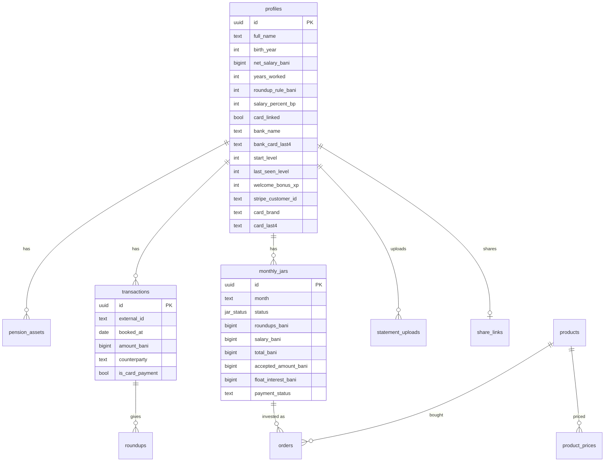
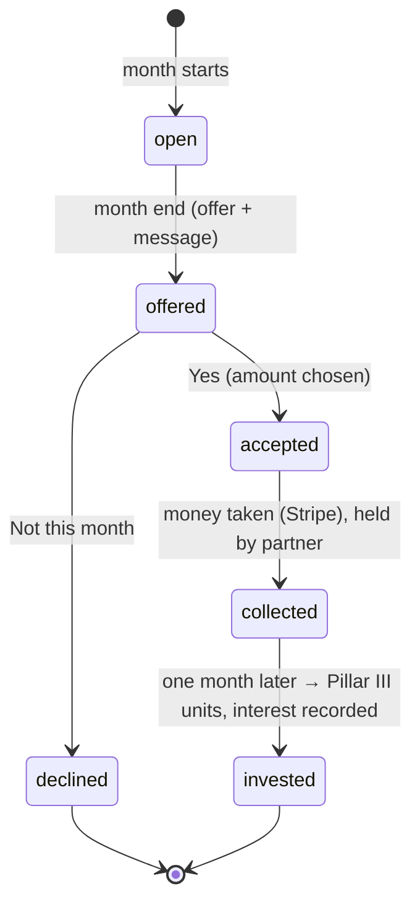

# Data model

All tables live in Supabase Postgres and are created by the migrations in `supabase/migrations/` (applied in order with `npx supabase db push`). Money columns end in `_bani` and hold integers.

## Tables

| Table | One row is… | Written by |
|---|---|---|
| `profiles` | a user: answers, settings, levels, bank and card info | onboarding, Profile, actions |
| `pension_assets` | a Pillar II / III balance on a date | onboarding, Profile |
| `transactions` | a bank transaction (mock bank or a bank-statement PDF) | server |
| `roundups` | the round-up of one card payment in one month | server (`rebuildJar`) |
| `monthly_jars` | one month's counter and what happened to it | server (money flow) |
| `orders` | Pillar III fund units bought for a month | server (`investJar`) |
| `products`, `product_prices` | the Pillar III product and its unit prices | seed |
| `statement_uploads` | an uploaded PDF and what the AI read | server |
| `share_links` | a public "shared island" card | server |
| `stripe_events` | a Stripe webhook already handled | webhook |

## A month's life: `monthly_jars.status`

`open` and `offered` months are recalculated whenever payments or settings change; answered months never change.

## Storage buckets

| Bucket | Public? | Holds |
|---|---|---|
| `statements` | private | uploaded PDFs, in a folder per user (`<userId>/…`) |
| `share-images` | public | the PNG preview of a shared island (needed by WhatsApp / LinkedIn) |

## Migrations, in order

| File | Adds |
|---|---|
| `…160000_init.sql` | core tables, enums, row-level security |
| `…190000_align_with_rules_and_ui.sql` | round-up options, allocation fixes |
| `…210000_lifestyle_app.sql` | the lifestyle app: jar statuses, offers, uploads, `statements` bucket |
| `…230000_qol_start_level_and_sharing.sql` | `start_level`, `share_links`, `share-images` bucket |
| `…240000_stripe_card.sql` | card columns, `payment_status`, `stripe_events` |
| `…000000_open_banking.sql` | bank name + card last 4 |
| `…001000_bank_statements.sql` | uploads of kind `bank` |
| `…100000_welcome_bonus_xp.sql` | `welcome_bonus_xp` |

After a schema change, regenerate the types: `npx supabase gen types typescript --linked > lib/supabase/database.types.ts`.
