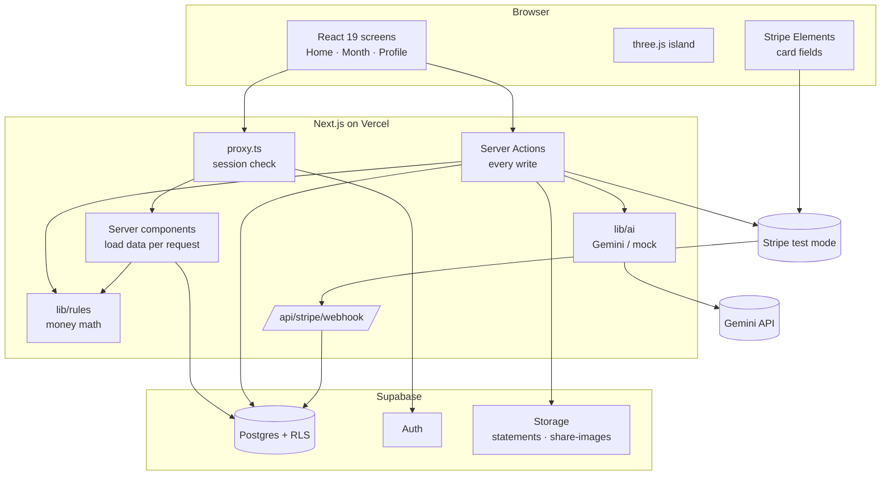

# Architecture overview

LifeGrowth is one **Next.js 16** app (App Router) talking to **Supabase** (database, auth, files), **Stripe** (card payments, test mode) and **Google Gemini** (reading PDFs). There is no separate backend: server logic lives in **Server Actions** and server components inside the same app.

## The layers

| Layer | Where | Job |
|---|---|---|
| **Screens** | `app/`, `components/` | Pages and UI. Client components only where there is interaction (forms, the 3D scene). |
| **Loaders** | `lib/data/` | Read the user's rows and turn them into what screens show (`getAppData`, `lifestyleNumbers`). |
| **Actions** | `app/**/actions.ts` | Every write: validate with Zod, check the session, change the database, `refresh()`. |
| **Domain logic** | `lib/server/` | The monthly flow (offer → collect → invest), mock bank, statement import, Stripe client. |
| **Money rules** | `lib/rules/` | Pure, deterministic functions in integer bani. No database, no network, fully unit-tested. |
| **AI** | `lib/ai/` | Model switch (Gemini / Groq / mock), PDF reader, monthly message. Always with a fallback. |
| **Database** | `supabase/migrations/` | Tables, row-level security policies, storage buckets. |

## Design principles

1. **Deterministic money.** Every amount is an integer number of **bani**. Rules live in `lib/rules/` with named, sourced constants (`config.ts`). The AI never computes a number shown to the user.
2. **Pure core, thin edges.** `lifestyleNumbers()` takes rows and returns numbers with no side effects, so the page, the actions, the seed script and the tests all agree.
3. **The session decides who you are.** Actions never take a user id from the browser; they read it from the Supabase session.
4. **Everything has a fallback.** No AI key → labelled sample values. No Stripe keys → card payments off, the app still works. AI fails on a PDF → a manual form opens.
5. **Honest by design.** Estimates in today's money, inflation subtracted, the business model written on every offer.

## Tech choices

| Need | Choice | Why |
|---|---|---|
| Web app | Next.js 16, React 19 | Server components + Server Actions = no separate API to build |
| Data + auth + files | Supabase | Postgres with row-level security, auth and storage in one |
| Payments | Stripe Elements, SetupIntents, PaymentIntents | Card data never touches our server; test mode for the demo |
| 3D | three.js + @react-three/fiber | Low-poly scene from primitives, no model files |
| AI | Gemini (with mock mode) | Reads PDFs natively; free tier |
| Validation | Zod | Every action input and every AI answer |
| Styling | Tailwind CSS 4 | Fast, consistent with the design |
