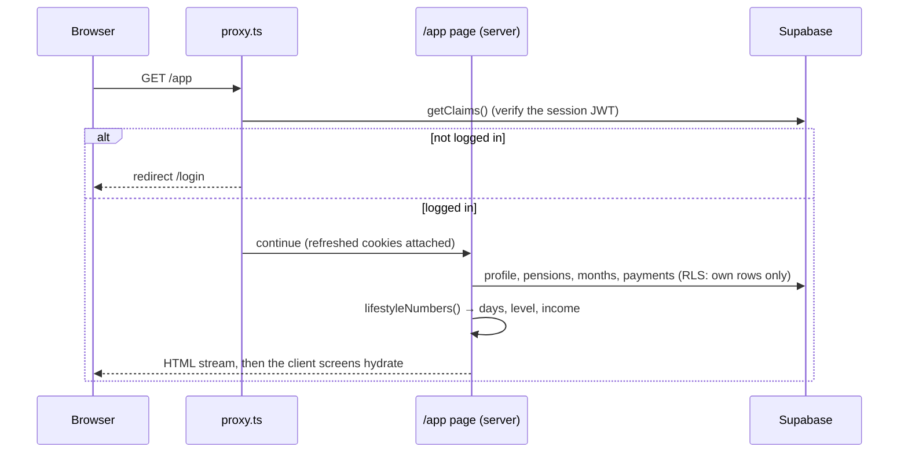
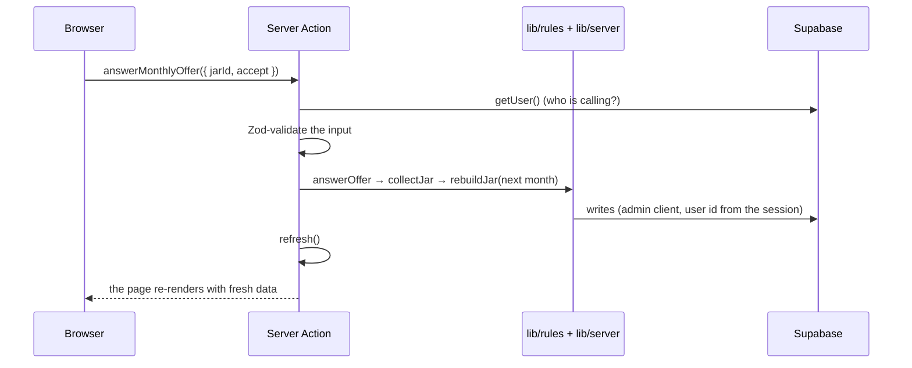

# Request lifecycle

## Loading a page



1. **`proxy.ts`** (Next 16's replacement for middleware) runs before every page. It refreshes the Supabase session cookie and guards routes:
   - `/app`, `/onboarding`, `/admin` → logged-out users go to `/login`;
   - `/login` → logged-in users go to `/app`.
2. **The page** renders a static shell and streams the user's data inside `<Suspense>`. Loaders call `await connection()`, so per-user data is never prerendered (`cacheComponents` is on).
3. **`getAppData()`** (`lib/data/app-data.ts`) reads everything the three tabs need in one go and returns an `AppData` object. Screens never fetch on their own.
4. **`/app`** redirects to `/onboarding` until onboarding is finished.

## Pressing a button (a Server Action)



Every action follows the same shape:

```ts
export async function updateSettings(input: SettingsInput) {
  const userId = await requireUserId()        // from the session, never from the browser
  const settings = SettingsInput.parse(input)  // Zod
  // ... write ...
  refresh()                                    // re-render with fresh data
}
```

## Two Supabase clients

| Client | File | Used for |
|---|---|---|
| **User client** | `lib/supabase/server.ts` | Reads and simple writes; row-level security limits it to the user's own rows. |
| **Admin client** | `lib/supabase/admin.ts` | Server-only writes users may not make themselves (statuses of monthly jars, round-ups, upload results). Always scoped by the session's user id. |

## Webhooks

Stripe calls `POST /api/stripe/webhook` after a payment. The route verifies the signature, stores the event id in `stripe_events` (duplicates are ignored) and updates the month's `payment_status`. See [Stripe payments](../features/stripe-payments.md).
