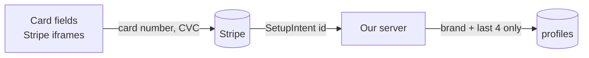

# Security

## Users only see their own data

- **Row-level security (RLS)** is on for every table. Policies allow a user to read their own rows only (`user_id = auth.uid()`).
- Statuses users must not change themselves (a month's status, round-ups, upload results, webhook events) are written **only by the server**, with the admin client, scoped by the user id from the session.
- PDFs go to a **private bucket**, in a folder named after the user; storage policies stop anyone reading or writing another user's folder.

## Who is calling is decided on the server

- `proxy.ts` verifies the session JWT with `getClaims()` on every request.
- Every Server Action starts with `requireUserId()` from the session. **No action accepts a user id from the browser.**
- Every action input is validated with **Zod**, and so are the AI's answers.

## Card data never reaches our server

- The card form uses **Stripe Elements**: the fields are Stripe's own iframes, so the digits go straight to Stripe.
- We store only Stripe's ids, the brand and the last 4 digits.
- The server **refuses live keys** (`sk_live_…`); only test mode runs.
- Pressing "Yes" twice can't charge twice: each charge has an **idempotency key** per month, amount and card.
- Webhooks are accepted only with a valid **Stripe signature**, and each event id is handled once.

## Open Banking is read-only

The bank connection (demo) only **reads** card payments to compute round-ups. Money moves only through Stripe, and only after the user taps **Yes**.

## Secrets

- Secrets live in `.env.local` (never committed) and in Vercel's environment variables.
- Only three values reach the browser, all public by design: the Supabase URL, the Supabase publishable key and the Stripe publishable key.
- The AI receives only fictional demo PDFs in this prototype. With real statements we would strip personal data first and sign a data-processing agreement with the provider.

## Admin

- `/admin` is shown only to the account whose email equals `ADMIN_EMAIL`; anyone else gets a 404.
- It shows totals only, never names.
