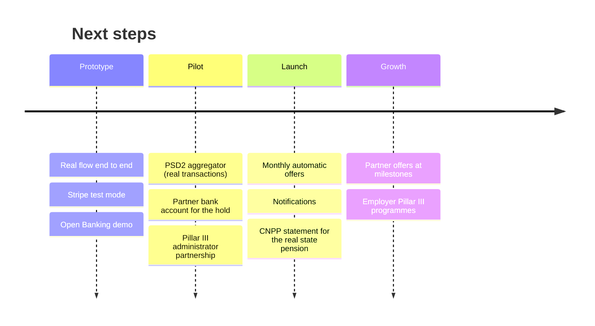

# Limitations and roadmap

## What is simulated today

| Part | In the prototype | For real |
|---|---|---|
| Bank connection | Open Banking **(demo)**: fictional bank and transactions | a licensed PSD2 aggregator |
| Payments | Stripe **test mode**: no real money | Stripe live, with a partner bank account |
| Pillar III | units recorded in the database | a partner pension administrator |
| Time | **Simulate end of month** moves a month forward | a monthly scheduled job |
| AI | Gemini, or labelled sample values without a key | Gemini with a data-processing agreement |
| Admin numbers | include 338 fictional savers | real users |

## Known limits of the model

- Estimates in today's money with cautious, sourced assumptions; not investment advice.
- The state pension is estimated from salary and years (48% for a full career), not from the user's real CNPP points.
- 2025 inflation comes from secondary sources citing INS.
- One month of interest per contribution is small; the business needs scale.

## Roadmap

1. **Real bank data** through a licensed PSD2 aggregator; `rebuildJar()` doesn't change.
2. **Partner bank** for the one-month hold and the interest share.
3. **Pillar III administrator** partnership (ASF marketing agent).
4. **Monthly automation**: a scheduled job instead of "Simulate end of month", with notifications.
5. **More from documents**: gross salary from Pillar II contributions, the real state pension from a CNPP statement.
