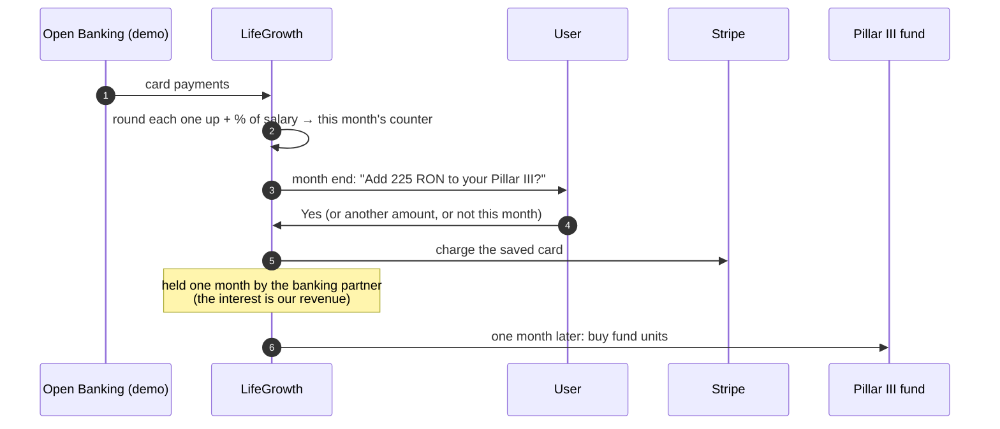

# The monthly loop

The heart of LifeGrowth: `lib/server/jar.ts` and `lib/server/money-flow.ts`.

## 1 · The counter (`rebuildJar`)

For a month, `rebuildJar()`:

1. takes the user's **card payments** in that month (`transactions.is_card_payment`);
2. rounds each one up with the user's rule (`roundUp()`), e.g. 143.20 RON with a 5 RON step → +1.80 RON, and writes one `roundups` row per payment;
3. adds the **salary share** (net salary × % chosen);
4. saves the totals in `monthly_jars` (`roundups_bani`, `salary_bani`, `total_bani`).

Only `open` and `offered` months are rebuilt, so changing the rule or the salary updates the current month but never an answered one.

## 2 · The offer (month end)

"**Simulate end of month**" (`simulateMonthEnd()`) is the demo's time machine:

1. money held for one month goes on to **Pillar III** (`investJar`), with the interest recorded;
2. the mock bank delivers the rest of the month's card payments;
3. the month becomes an **offer** (`offerJar`) with a short message: the AI phrases a sentence from numbers our code computed, e.g. *"Rares, you saved 195 RON in October. That's +10 days of freedom, enough to unlock an old car."* If the AI isn't available or breaks a rule, a fixed sentence is used.

## 3 · The answer

| Button | What happens |
|---|---|
| **Yes, add it** | With a saved card: Stripe charges it (`payMonthWithCard`), the month is **accepted** and **collected**. Without a card: "Add a card in Profile to pay". |
| **Another amount** | Any amount up to 2× the suggestion. |
| **Not this month** | The month is **declined**. |

After any answer the **next month opens right away**, so settings changes always have a month to apply to.

## 4 · The hold and Pillar III

- `collectJar()` records when the money left the user's account and sets `invest_on` one month later.
- `investJar()` buys Pillar III **fund units** at that day's unit price (`orders`) and records the interest earned while holding the money: `floatInterestBani(amount, days)` at 5% a year.

That interest is the [business model](../business/business-model.md).

## The Month tab

- This month's counter (round-ups + salary share, with **Change** links to the settings) or the offer.
- **Card payments**: this month and the 3 before, with round-ups; older months fold away; months before the user joined show *"round-ups would have saved you X RON"*.
- **Past months**: *In your Pillar III*, *With our partner until 28 Nov*, or *Skipped*.
