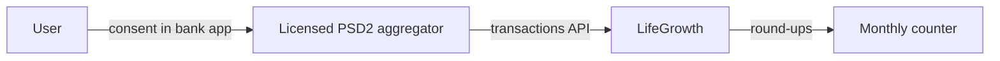

# Open Banking (demo)

Round-ups need the user's **card payments**. In Europe these come from the bank, with the user's permission, under **PSD2** (Romania: Law 209/2019, supervised by BNR). LifeGrowth simulates that connection with fictional data.

:::note Two separate jobs
**Open Banking reads** payments to compute round-ups; it can't move money. **Stripe charges** the monthly amount. A card number alone can't show transactions.
:::

## The demo flow

`components/bank/demo-bank.tsx`: the same screens as a real PSD2 consent.

1. **Choose your bank**: *Demo Bank* (the one demo provider).
2. **Which card do you pay with?** The last 4 digits only; the bank already knows the rest.
3. **Allow LifeGrowth to read your payments**: read-only, last 90 days and new ones, access for 180 days. Any 4-digit code confirms.

Then `connectCard()` stores the bank and card's last 4 on the profile and **imports the last 3 months of payments plus this month so far** (`importBankHistory`), as a real connection would.

In Profile → *Card and bank*, **Disconnect** stops reading new payments (to connect another card); payments already read stay in the history.

## Where the fake payments come from

`lib/server/mock-bank.ts` generates the same 12 card payments every month (Lidl, Bolt, Glovo, Kaufland, Starbucks, Netflix…), plus rent, electricity and salary, with small month-to-month variations. Every row has a stable id per user, so importing a month twice adds nothing.

## No bank connection? Upload a statement

A bank statement PDF works as a fallback: the [PDF reader](pdf-reader.md) lists its transactions and adds the card payments, **skipping ones already known** (same day + same amount + same first word of the merchant).

## For real

- Use a **licensed aggregator** (e.g. Salt Edge, Tink, Enable Banking, or Romanian providers) instead of our own license.
- Replace `mock-bank.ts` with a client for its API; store the consent id in a `bank_connections` table; sync on a schedule.
- `rebuildJar()` stays the same: the round-up engine doesn't care where payments come from.

Full write-up: `docs/BANK_IMPLEMENTATION.md` in the repository.
