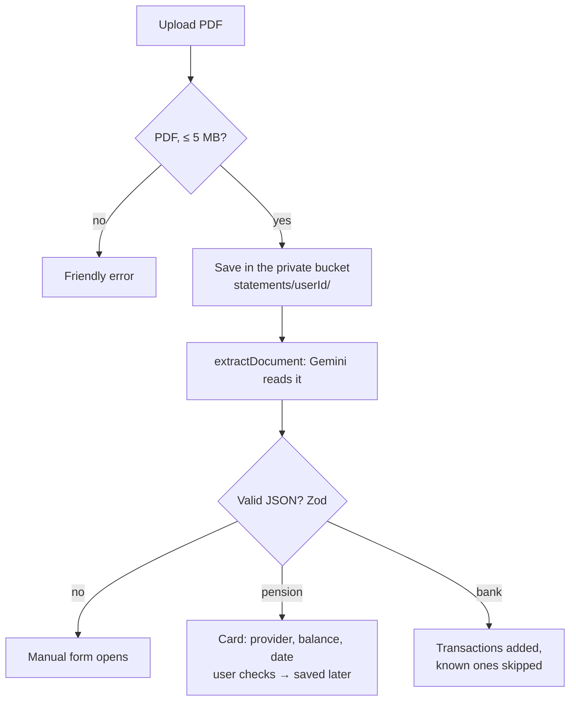

# PDF reader and AI

## Where AI is used

| Feature | What the AI does | What it never does |
|---|---|---|
| **PDF reader** | reads a document and says what it is: a pension statement (provider, balance, date) or a bank statement (transactions) | compute anything; save anything without the user |
| **Monthly message** | phrases one short sentence from numbers our code computed | invent numbers (if it doesn't use the exact days, a fixed sentence is used) |

All financial calculations are plain, tested code in `lib/rules/`.

## The reader, step by step

- `uploadDocument()` (`app/onboarding/actions.ts`) stores the file, logs it in `statement_uploads` and calls `extractDocument()` (`lib/ai/extract-document.ts`).
- The model answers **JSON only**, validated with Zod; balances are converted to integer bani by our code.
- Each upload box says what it accepts: onboarding step 1 takes pension statements, step 4 bank statements, Profile both.

### Bank statements

`importStatementTransactions()` (`lib/server/statement-import.ts`):

- a payment is **already known** if it has the same day, the same amount and the same first word of the merchant ("LIDL 0123 BUCURESTI" = "Lidl");
- each imported row gets an id derived from those values, so uploading the same statement twice adds nothing;
- only the **open month's** round-ups change; answered months stay as they were;
- the result: *"Found 13 transactions (11 card payments): 10 new, 3 you already had. +10.85 RON in round-ups this month."*

## Providers and fallbacks

`lib/ai/model.ts` picks the provider from `AI_PROVIDER` and the available keys:

| Provider | Reads PDFs? | Used when |
|---|---|---|
| **Gemini** | yes | `AI_PROVIDER=gemini` with a key |
| **Groq** (Llama 3.3 70B) | no | `AI_PROVIDER=groq` with a key: monthly message only |
| **mock** | sample values | no key, or `AI_PROVIDER=mock` |

In mock mode the reader returns **labelled sample values** ("Sample values (AI is off in this demo)"), picked by file name, so the demo PDFs in `data/demo/` always work.

## Ideas for more data

The same statements hold more: monthly Pillar II contributions reveal the gross salary (they're 4.75% of it), the join date hints at years worked, and a CNPP statement would give the real state pension. See `docs/TIPS.md` in the repository.
