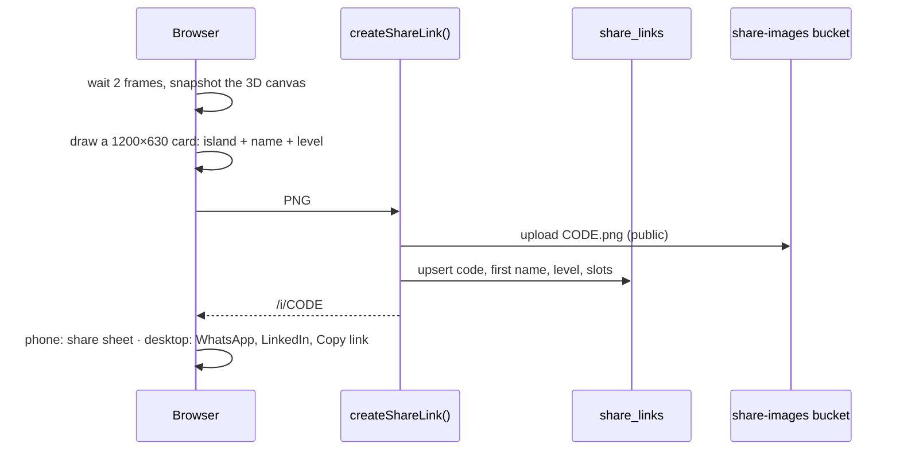

# Sharing the island

**Home → Share my island** creates a public link like `/i/Ab3dEf9hJk` that shows a pop-up with the user's island, **first name** and **level**, and a button **"Start saving for your pension"**. Nothing else is shared: no days, no money, no surname.

## How it works

- The canvas keeps its last frame (`preserveDrawingBuffer`) so it can be photographed.
- One link per user; sharing again updates the picture and level.
- `/i/[code]` is public, rendered on the server, with **Open Graph** tags so WhatsApp and LinkedIn show the preview image.
- The table has no public read policy: the page reads it with the server's admin client and returns only the safe columns.
