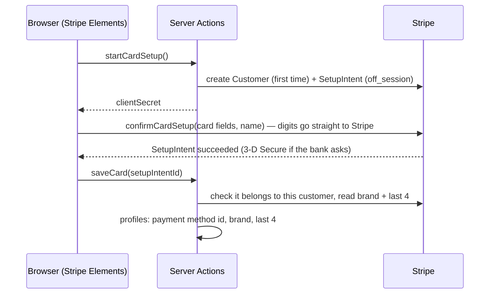

# Stripe payments

Stripe runs in **test mode** only. Files: `components/stripe/card-form.tsx`, `app/app/card-actions.ts`, `lib/server/stripe.ts`, `app/api/stripe/webhook/route.ts`.

## Saving a card

- The card number, expiry and CVC are **Stripe Elements** fields (iframes); our server never sees them. The name on the card is our own field.
- One card at a time: saving a new one detaches the old one.
- Stripe's "Save with Link" button is turned off.

## Charging the month

`payMonthWithCard({ jarId, amountBani })`:

1. checks the month is still `offered` and the amount ≤ 2× the suggestion;
2. creates a **PaymentIntent** in RON (bani are Stripe's smallest unit) with the saved card, `off_session` and `confirm: true`, and an **idempotency key** per month + amount + card, so a double tap can't charge twice;
3. **succeeded** → the month is accepted and collected, `payment_status = succeeded`, the next month opens;
4. **3-D Secure needed** → the browser shows Stripe's confirmation (`handleNextAction`), then `completeCardPayment()` checks with Stripe that it was really paid;
5. **declined** → a clear message; the offer stays.

## Webhook

`POST /api/stripe/webhook`:

- verifies the **signature** with `STRIPE_WEBHOOK_SECRET` on the raw body;
- stores the event id in `stripe_events`; a repeated event is ignored;
- `payment_intent.succeeded` / `payment_intent.payment_failed` → `monthly_jars.payment_status`.

## Test cards

| Card | Result |
|---|---|
| `4242 4242 4242 4242` | always succeeds |
| `4000 0027 6000 3184` | 3-D Secure every time |
| `4000 0000 0000 0341` | saves; every charge declined |
| `4000 0000 0000 0002` | declined when saving |

Any future expiry, any CVC. Full test plan: `docs/STRIPE_TESTING.md` in the repository.
