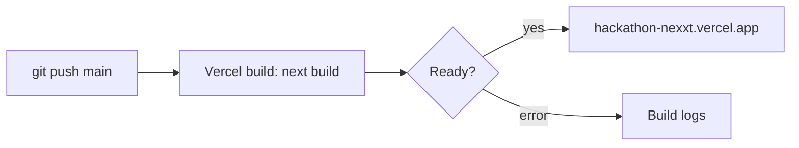

# Deployment

## The app on Vercel

The live app, **[hackathon-nexxt.vercel.app](https://hackathon-nexxt.vercel.app)**, is deployed by Vercel from the `main` branch: **every push to `main` builds and publishes a new version** in 1–3 minutes.



### Setting it up

1. Import the GitHub repository in Vercel (framework: Next.js, default settings).
2. **Settings → Environment Variables**: add the variables from [Environment variables](../reference/environment.md). You can paste a whole `.env` file into the *Key* field; remove end-of-line comments and the local-only variables.
3. **Deployments → latest → ⋯ → Redeploy** after adding or changing variables. They are read at build time.
4. **Supabase → Authentication → URL Configuration**: set the Site URL to the Vercel address.
5. Optional, Stripe webhooks: add an endpoint `https://<app>/api/stripe/webhook` (events `payment_intent.succeeded`, `payment_intent.payment_failed`) and put its secret in `STRIPE_WEBHOOK_SECRET`.

### When it breaks

| Symptom | Cause |
|---|---|
| Every page: *Internal Server Error* | A Supabase variable is missing or misnamed. `proxy.ts` runs before every page and needs `NEXT_PUBLIC_SUPABASE_URL` and `NEXT_PUBLIC_SUPABASE_PUBLISHABLE_KEY`. |
| Variables added but nothing changed | Redeploy: a deployment only sees the variables that existed when it was built. |
| PDF upload says the AI can't read it | The Gemini key is invalid or missing. Set `AI_PROVIDER=mock` for labelled sample values. |
| "Add a card" is disabled | Stripe test keys are missing. |

## These docs

This site is a separate [Docusaurus](https://docusaurus.io) project in `docs-site/`.

```bash
cd docs-site
npm install
npm start        # http://localhost:3000, live reload
npm run build    # static site in docs-site/build
```

To publish it, create a second Vercel project from the same repository with **Root Directory** set to `docs-site` (framework preset: Docusaurus).
