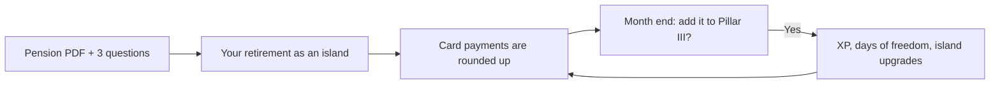

# Introduction

**LifeGrowth** shows people in their 30s **how they would live in retirement**, as a small low-poly 3D island built from their real pension numbers. Every card payment is rounded up; once a month the user adds that money to their **Pillar III** pension with one tap, and the island upgrades from a tent to a villa.

Built for the **nexxt hackathon, "Rethinking Financial Futures"**: making the financial future more accessible and relevant for people in Romania.

:::info Prototype
All money is **test money** (Stripe test mode), all bank data is **fictional** (Open Banking demo), and nothing here is investment advice. See [Limitations and roadmap](../business/limitations-roadmap.md).
:::

## The problem

- Retirement is decades away and a pension statement is an abstract PDF, so people in their 30s don't act on it.
- In Romania the state pension replaces only about **48%** of an average net salary (CNPP, OECD).
- Pillar III (voluntary pension) is tax-deductible up to **400 €/year**, but few people use it.

## The idea in one loop

1. **See it.** Upload a pension statement and answer three questions. The app projects your income at 65, how much of today's life it covers, and the **days of freedom** your savings buy. It shows this as an island.
2. **Grow it.** Your bank connection (Open Banking) reads card payments; each one is rounded up. A small share of your salary can be added too.
3. **Decide once a month.** "Add 225 RON to your Pillar III?" One tap. The card is charged (Stripe), the money reaches Pillar III, and the island levels up.

## How to read these docs

| Tab | For | Start with |
|---|---|---|
| **Guide** | everyone | [Try it in 5 minutes](try-it.md) |
| **Architecture** | developers, technical judges | [Overview](../architecture/overview.md) |
| **Features** | the team presenting it | [Onboarding](../features/onboarding.md) |
| **Reference** | whoever changes the code | [Money rules](../reference/money-rules.md) |
| **Business** | the pitch | [Business model](../business/business-model.md) |

## Key facts

- **Live app:** [hackathon-nexxt.vercel.app](https://hackathon-nexxt.vercel.app)
- **Code:** [github.com/rarescazan30/hackathon-nexxt](https://github.com/rarescazan30/hackathon-nexxt)
- **Stack:** Next.js 16 + React 19, Supabase, Stripe (test mode), three.js, Google Gemini, Zod.
- **Rule of the codebase:** all money math is deterministic code in integer **bani** (1 RON = 100 bani), in `lib/rules/`. AI only reads documents and phrases one sentence.
